<div align="center">

<picture>
  <source media="(prefers-color-scheme: dark)" srcset="assets/hero-dark.svg">
  
</picture>

<h1>👋 Hey, I'm Kit</h1>

<p><strong>Developer · Android · Linux · Networking · Game Development</strong></p>
<p><em>Build. Break. Learn. Fix. Repeat.</em></p>

<a href="https://github.com/redmi9cnfc"></a>
<a href="https://github.com/redmi9cnfc?tab=followers"></a>

<picture>
  <source media="(prefers-color-scheme: dark)" srcset="assets/about-dark.svg">
  
</picture>

</div>

## 🧑‍💻 About Me

I'm Kit — also known on GitHub as **[redmi9cnfc](https://github.com/redmi9cnfc)**. I enjoy exploring how systems work, customizing Android and Linux, building useful tools, and experimenting with networking and game development.

<table>
  <tr>
    <td align="center" width="25%"><h3>🐍 Code</h3>Python<br>Kotlin<br>C#<br>Bash<br>JavaScript</td>
    <td align="center" width="25%"><h3>📱 Android</h3>AOSP<br>GSI<br>ADB<br>Fastboot<br>Root tools</td>
    <td align="center" width="25%"><h3>🐧 Linux</h3>Arch<br>Debian<br>Git<br>Bash<br>OpenWrt</td>
    <td align="center" width="25%"><h3>🎮 Games</h3>C#<br>Unity<br>Game dev<br>Gameplay<br>Experiments</td>
  </tr>
</table>

<p align="center"><em>“Don't just use technology. Understand it.”</em></p>

## ⚡ Languages

| Language | What I use it for | Familiarity |
|---|---|---|
| 🐍 **Python** | Automation, scripts, bots and utilities | ████████████████░░ |
| 🟣 **Kotlin** | Android applications and tools | ██████░░░░░░░░░░░░ |
| 🔷 **C#** | Unity and application development | ██████░░░░░░░░░░░░ |
| 💻 **Bash** | Linux, Android and automation | ███████████████░░░ |
| 🟨 **JavaScript** | Web projects and experiments | █████████░░░░░░░░░ |
| 🌐 **HTML / CSS** | Web interfaces | ██████████░░░░░░░░ |

<p align="center"></p>

## 📱 Android

<table>
  <tr>
    <td width="33%"><h3>🔧 System</h3>AOSP<br>Custom ROMs<br>GSI<br>Root<br>Magisk<br>KernelSU<br>KernelSU Next<br>SukiSU Ultra</td>
    <td width="33%"><h3>🛠️ Tools</h3>ADB<br>Fastboot<br>Termux<br>Android Studio<br>Boot and recovery<br>System modification</td>
    <td width="33%"><h3>🚀 Development</h3>Kotlin<br>Android SDK<br>APIs<br>Automation<br>System utilities<br>Android apps</td>
  </tr>
</table>

<p align="center">
  
  
  
</p>

## 🐧 Linux & Systems

<table>
  <tr>
    <td width="50%"><h3>🖥️ Linux</h3>Linux · Arch-based systems · Debian · Bash · Git · System customization · Automation</td>
    <td width="50%"><h3>🌐 Networking</h3>OpenWrt · VPN · Proxy · DNS · Routing · Network automation</td>
  </tr>
</table>

## 🎮 Game Development

<p align="center"></p>

I experiment with **C# and Unity** to explore game mechanics, gameplay systems, prototypes, and interactive applications.

## 🚀 What I Build

| 📱 Android | 🐍 Python | 🎮 Unity | 🌐 Networking |
|---|---|---|---|
| Apps, ROMs, modules and system tools | Bots, scripts, automation and utilities | Games, prototypes and C# projects | OpenWrt, VPN, DNS and routing |

## 🧠 Tech Arsenal

| Category | Technologies |
|---|---|
| 💻 Languages | Python · Kotlin · C# · Bash · JavaScript · HTML · CSS |
| 📱 Android | Android · AOSP · GSI · ADB · Fastboot · Magisk · KernelSU · KernelSU Next · SukiSU Ultra |
| 🐧 Linux | Linux · Arch · Debian · Bash · Git |
| 🎮 Game Development | C# · Unity · Game Development |
| 🌐 Networking | OpenWrt · VPN · DNS · Proxy · Routing |
| 🛠️ Tools | GitHub · VS Code · Android Studio · Termux |

## 🧩 Featured Projects

<div align="center">

<a href="https://github.com/redmi9cnfc/Zapret_fix"><picture><source media="(prefers-color-scheme: dark)" srcset="assets/project-zapret-fix-dark.svg"></picture></a>
<a href="https://github.com/redmi9cnfc/TV"><picture><source media="(prefers-color-scheme: dark)" srcset="assets/project-tv-dark.svg"></picture></a>
<a href="https://github.com/redmi9cnfc/Gravity_icons_lsposed"><picture><source media="(prefers-color-scheme: dark)" srcset="assets/project-gravity-icons-lsposed-dark.svg"></picture></a>
<a href="https://github.com/redmi9cnfc/OpenIPTVApp"><picture><source media="(prefers-color-scheme: dark)" srcset="assets/project-openiptvapp-dark.svg"></picture></a>

</div>

## 📊 GitHub Statistics

<p align="center">
  
  
</p>

<p align="center">
  <picture><source media="(prefers-color-scheme: dark)" srcset="assets/stats-dark.svg"></picture>
</p>

## 🐍 Contribution Snake

<p align="center">
  <picture>
    <source media="(prefers-color-scheme: dark)" srcset="https://raw.githubusercontent.com/Platane/snk/output/github-contribution-grid-snake-dark.svg">
    <source media="(prefers-color-scheme: light)" srcset="https://raw.githubusercontent.com/Platane/snk/output/github-contribution-grid-snake.svg">
    
  </picture>
</p>

<p align="center"><code>🐍 Keep coding, keep contributing!</code></p>

## 👾 Pac-Man

<p align="center">
  <picture>
    <source media="(prefers-color-scheme: dark)" srcset="https://raw.githubusercontent.com/kzolotarev95/kzolotarev95/output/pacman-contribution-graph-dark.svg">
    <source media="(prefers-color-scheme: light)" srcset="https://raw.githubusercontent.com/kzolotarev95/kzolotarev95/output/pacman-contribution-graph.svg">
    
  </picture>
</p>

## 🔥 GitHub Streak

<p align="center">
  
</p>

<p align="center">
  <picture><source media="(prefers-color-scheme: dark)" srcset="assets/streak-dark.svg"></picture>
</p>

## 🏆 GitHub Trophies

<p align="center"></p>

## 💻 Terminal

```text
$ whoami
Kit

$ neofetch
OS        → Linux
Languages → Python / Kotlin / C#
Engine    → Unity
Platform  → Android
Network   → OpenWrt
Editor    → VS Code

$ systemctl status creativity
● creativity.service
   Loaded: enabled
   Active: running

$ echo $MISSION
BUILD → BREAK → LEARN → FIX → REPEAT
```

## 💡 Developer Philosophy

> Don't just use technology. Understand it.
>
> If it works — find out why.  
> If it doesn't work — fix it.  
> If nobody made it — build it.

<div align="center">

---

**⚡ Thanks for visiting my profile ⚡**

<picture>
  <source media="(prefers-color-scheme: dark)" srcset="assets/wave-dark.svg">
  
</picture>

<a href="https://github.com/redmi9cnfc?tab=repositories"><picture><source media="(prefers-color-scheme: dark)" srcset="assets/button-2-dark.svg"></picture></a>

<sub>Build · Break · Learn · Fix · Repeat</sub>

</div>
