<picture><source media="(prefers-color-scheme: dark)" srcset="assets/hero-dark.svg"></picture>

<picture><source media="(prefers-color-scheme: dark)" srcset="assets/social-l-dark.svg"></picture><a href="https://t.me/kraftplayo"><picture><source media="(prefers-color-scheme: dark)" srcset="assets/social-1-dark.svg"></picture></a><picture><source media="(prefers-color-scheme: dark)" srcset="assets/social-r-dark.svg"></picture>

<picture><source media="(prefers-color-scheme: dark)" srcset="assets/about-dark.svg"></picture>

<picture><source media="(prefers-color-scheme: dark)" srcset="assets/stack-dark.svg"></picture>

<a href="https://github.com/redmi9cnfc/Zapret_fix"><picture><source media="(prefers-color-scheme: dark)" srcset="assets/project-zapret-fix-dark.svg"></picture></a>&nbsp;<a href="https://github.com/redmi9cnfc/TV"><picture><source media="(prefers-color-scheme: dark)" srcset="assets/project-tv-dark.svg"></picture></a>

<a href="https://github.com/redmi9cnfc/Gravity_icons_lsposed"><picture><source media="(prefers-color-scheme: dark)" srcset="assets/project-gravity-icons-lsposed-dark.svg"></picture></a>&nbsp;<a href="https://github.com/redmi9cnfc/redmi9cnfc"><picture><source media="(prefers-color-scheme: dark)" srcset="assets/project-redmi9cnfc-dark.svg"></picture></a>

<picture><source media="(prefers-color-scheme: dark)" srcset="assets/stats-dark.svg"></picture>

<picture><source media="(prefers-color-scheme: dark)" srcset="assets/streak-dark.svg"></picture>

<picture><source media="(prefers-color-scheme: dark)" srcset="assets/wave-dark.svg"></picture>

<a href="https://www.youtube.com/watch?v=dQw4w9WgXcQ"><picture><source media="(prefers-color-scheme: dark)" srcset="assets/button-1-dark.svg"></picture></a>

<a href="https://metawka.github.io/expressive-profile/?from=redmi9cnfc"><picture><source media="(prefers-color-scheme: dark)" srcset="assets/credit-dark.svg"></picture></a>

